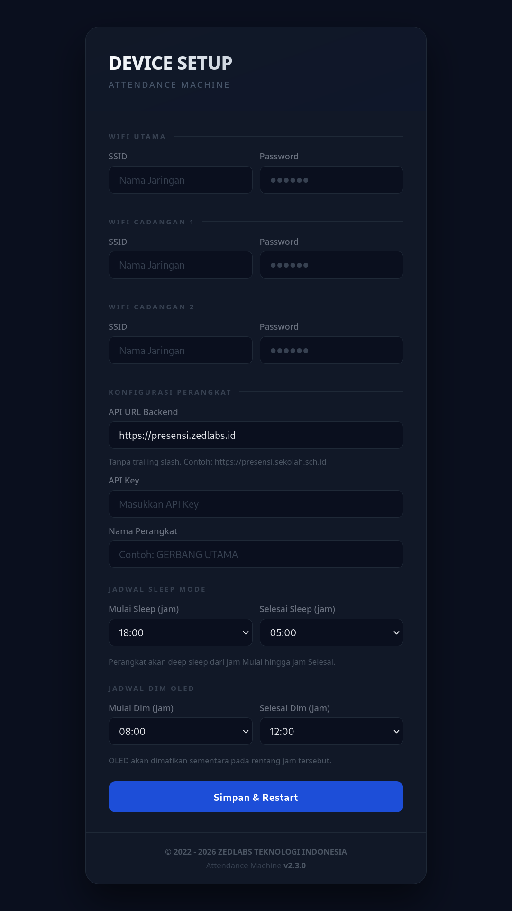

# Attendance Machine

Firmware presensi berbasis IoT untuk ESP32-C3, dirancang untuk jaringan yang tidak stabil. Arsitekturnya *hybrid*: presensi tetap tercatat saat offline (antrean di SD card atau buffer NVS), lalu dikirim ke server saat koneksi kembali.

**Versi dokumen: firmware v2.3.7.** Dokumen ini menggantikan `README.md` dan `requirements.md` lama.



---

## 1. Hardware

| Komponen | Keterangan |
|---|---|
| Board | ESP32-C3 Super Mini (single-core RISC-V). Profil Arduino `ESP32C3 Dev Module`, FQBN `esp32:esp32:esp32c3` |
| RFID | MFRC522 |
| Display | OLED SSD1306 128x64 (0,96") |
| Penyimpanan | Modul SD card (SdFat) |
| Audio | Buzzer pasif |
| Daya | Charger 4056 + baterai |
| RTC (**opsional**) | DS3231/DS1307, alamat I2C `0x68`. Sangat disarankan untuk lokasi dengan WiFi atau listrik tidak stabil |

### Pin

| Fungsi | GPIO |
|---|---|
| SPI SCK / MOSI / MISO | 4 / 6 / 5 |
| RFID SS / RST | 7 / 3 |
| SD CS | 1 |
| OLED SDA / SCL | 8 / 9 |
| Buzzer | 10 |
| Tombol BOOT (factory reset) | 0 |

- RC522 dan SD card berbagi bus SPI, dilindungi `xSdMutex`.
- RTC berbagi bus I2C dengan OLED (GPIO 8/9), dilindungi `xDisplayMutex`. Clock I2C diturunkan ke 100 kHz saat akses RTC (batas DS1307).
- GPIO 8/9 adalah strapping pin yang dipakai I2C.

---

## 2. Build, Library, dan Environment

| Item | Nilai |
|---|---|
| Tools | Arduino IDE 2.3.6 / arduino-cli |
| Board package | esp32 (Espressif) 3.3.12 |
| Partisi | Minimal SPIFFS (1,9 MB APP with OTA / 128 KB SPIFFS), `PartitionScheme=min_spiffs` |
| Backend | Laravel 11 + Filament 3 (PHP 8.4), di belakang Cloudflare |

**Library:** MFRC522 1.4.12, Adafruit SSD1306 2.5.17, Adafruit GFX 1.12.6, Adafruit BusIO 1.17.4, ArduinoJson 7.4.3 (API v7: `JsonDocument`, `to<JsonArray>()`), SdFat 2.3.0.

**Perintah:**
```bash
# Compile
arduino-cli compile --clean --warnings all \
  --fqbn esp32:esp32:esp32c3:CDCOnBoot=cdc,PartitionScheme=min_spiffs \
  --export-binaries .

# Upload USB
arduino-cli upload -p /dev/ttyACM0 --fqbn esp32:esp32:esp32c3:CDCOnBoot=cdc,PartitionScheme=min_spiffs .

# Wipe flash (opsional, membersihkan NVS/SPIFFS lama)
esptool --chip esp32c3 --port /dev/ttyACM0 erase-flash

# Rilis tanpa log serial
arduino-cli compile ... --build-property compiler.cpp.extra_flags=-DLOG_LEVEL=0

# Unit test host
g++ -std=c++17 -Wall -Wextra -fsanitize=address,undefined -I. test/test_pure.cpp -o /tmp/test_pure && /tmp/test_pure
```

**Ukuran v2.3.7:** 1.343.521 byte flash (68% dari 1.966.080), RAM global 97.512 byte (29%). v2.3.9 adalah 1.332.096 byte.

Warning dari library (`#warning File not defined because __has_include(FS.h)`, `"FILE_READ" redefined`, `"FILE_WRITE" redefined`) berasal dari tabrakan makro SdFat dan `FS.h` (ditarik `WebServer.h`). Aman diabaikan. Warning lain yang muncul berarti ada masalah di kode kita.

**Konfigurasi sdkconfig yang relevan:** bootloader rollback aktif, brownout level 7, task WDT panic, partisi `coredump` 64 KB (core dump ke flash aktif), flash encryption dan NVS encryption **mati**.

**Level log:** `LOG_LEVEL` 0=mati, 1=Error, 2=Warn, 3=Info (default), 4=Debug. Baris `[FW] FWVER:...` sengaja bukan `LOG_I` agar marker tetap ada saat `LOG_LEVEL=0`. Tidak ada log yang mencetak API key, SSID, atau password.

---

## 3. Aturan Pengembangan (wajib)

1. **Penempatan kode.** Fungsi pertama di `.ino` memicu `arduino-cli` menyisipkan prototipe otomatis sebelum tipe terdefinisi. Jangan menaruh fungsi di atas semua `struct`/`enum`. `verifyRollbackLater()` tetap setelah semuanya. Variabel global baru memakai tipe dasar (mis. `uint8_t`).
2. **Urutan mutex:** `xSdMutex` dulu, baru `xCacheMutex`. Jangan memanggil fungsi yang mengambil `xSdMutex` sambil memegangnya (tidak rekursif). Fungsi lookup RFID tidak mengambil mutex SD.
3. **`xDisplayMutex`** melindungi OLED **dan** bus I2C RTC. Akses RTC lewat `rtcBusLock()`/`rtcBusUnlock()`.
4. **NVS (`Preferences`)** selalu lewat `lockNvs()`/`unlockNvs()`.
5. **Waktu:**
   - Semua keperluan epoch (stempel, duplikat, filter umur) memakai `getEpochWithFallback()`, bukan `time(nullptr)`.
   - Pengecualian: `isTimeTrusted()` dan `anchorTimeFromSystem()`, yang memang harus membedakan jam sistem sungguhan dari estimasi.
   - Keputusan yang bergantung ketepatan jam (menerima scan, deep sleep) memakai `isTimeTrusted()`, bukan `isTimeValid()`.
   - `timeFromNvsOnly` diset di `setup()`. Jangan direset manual.
   - `MIN_VALID_EPOCH` harus selaras dengan `RTC_MIN_VALID_YEAR`.
6. **Polling berkala** (OTA, versi DB, heartbeat, config) wajib memakai `backoffInterval(base, failX)`, `backoffFail()` saat gagal, dan reset ke 0 saat sukses. **Dilarang** memasang backoff di `chunkedSync`, `nvsSyncToServer`, `kirimLangsung`.
7. **HTTPS:** setiap request membuat `WiFiClientSecure` sendiri lewat `applyTls()`. `TLS_VERIFY_CERT` harus tetap `1` di rilis.
8. **Pola waktu millis:** gunakan `(now - t0) >= durasi` atau selisih bertanda `(long)(now - t)`. Jangan `millis() < end`.
9. **Epoch yang dikirim ke server dan dihitung di CRC memakai `uint32`** (`unsigned long` di ESP32). `pure_logic.h` memakai `uint32_t` agar perilaku overflow identik di PC.
10. **Logika murni** (tanpa Arduino/FreeRTOS) ada di `pure_logic.h` dan diuji di PC: `crc8`, `recordCrc8`, `backoffInterval`, `isInWindow`, `compareFirmwareVersion`, `isValidMd5Hex`, `daysFromCivil`, `parseQueueIndex`, `otaVerFeed`. Perubahan fungsi-fungsi itu wajib menjalankan `test/test_pure.cpp` (71 pemeriksaan).
11. Jangan hardcode kredensial. Jangan menambah fitur di luar kebutuhan tanpa persetujuan. Perubahan minimal dan bisa di-review.
12. Nama device: maksimum 19 karakter, hanya huruf/angka/spasi/`-`/`_`/`.`.
13. Versi mengikuti semver, tag git `vX.Y.Z`.

---

## 4. Arsitektur Task

ESP32-C3 hanya punya satu core. Semua task berbagi core dan saling menyela lewat preemption.

| Task | Fungsi | Prioritas | Stack |
|---|---|---|---|
| `loop()` | Polling RC522 (di bawah mutex SD) → queue, cek jadwal sleep, deep sleep | n/a | n/a |
| `taskRfid` | Debounce, validasi, simpan/kirim presensi | 3 | 8192 |
| `taskSync` | Reconnect, health SD, OTA, RFID DB, sync, heartbeat, remote config, resync waktu | 2 | 8192 |
| `taskDisplay` | OLED, jadwal dim, factory reset | 1 | 12288 |

**Sinkronisasi:**
- `loop()` → `taskRfid`: Queue `xRfidQueue` (producer-consumer, panjang 8).
- Mutex: `xSdMutex` (SD **dan** SPI RC522), `xDisplayMutex` (OLED **dan** I2C RTC), `xConfigMutex`, `xNvsMutex`, `xCacheMutex`.
- Daftar admin ditukar atomik lewat `portENTER_CRITICAL`, jadi pembaca tidak pernah melihat daftar kosong saat SD dipasang ulang.
- `forceSyncRequested` diset `taskRfid` (kartu admin) dan dikonsumsi `taskSync`.
- Handshake deep sleep: `sleepRequested` + flag `parkRfid/parkSync/parkDisp`. Tidur hanya bila ketiga task sudah berhenti di titik aman.
- `taskSync` mengambil `now = millis()` **setelah** `processReconnect()`, karena fungsi itu bisa mengisi `timers.lastSync`.

---

## 5. Keamanan

### Kredensial
Disimpan terenkripsi di NVS namespace `cfg` (SSID ×3, password ×3, API key, API URL, nama device):
1. Kunci AES-128 = SHA-256(MAC + salt tetap) (`deriveAesKey`).
2. AES-128-CBC dengan IV acak per record. Blob: IV 16 + data 96 + panjang 1 byte. Blob format lama (65 byte) tetap terbaca.
3. Dekripsi hanya ke RAM saat dibutuhkan. `decryptBytes` menolak `len` melebihi isi blob.

Batas input: SSID 32, password WiFi 63, API key 95, API URL 79, nama device 19.

> ⚠️ **Batasan (diterima).** Salt ada di source, MAC bukan rahasia, CBC tanpa autentikasi. Ini hanya melindungi dari pembacaan sekilas, **bukan** dari penyerang yang memegang dump flash. Hardening penuh butuh flash encryption + NVS encryption ESP-IDF: membangun ulang core, mengubah partisi, burn eFuse yang **irreversible** (salah kunci = unit brick). Tidak diaktifkan. Mitigasi: API key unik per mesin dan rotasi saat mesin hilang.

- `WiFi.persistent(false)`: kredensial WiFi tidak disimpan driver, hanya di NVS terenkripsi aplikasi. Factory reset memanggil `esp_wifi_restore()` untuk menghapus sisa dari firmware lama.
- Kartu admin dapat dikloning dan `/admin_rfid.txt` plaintext di SD. Dampak terbatas pada tampilan status dan sync manual.
- Form `/save` tidak punya autentikasi selain password AP acak dan jendela 5 menit. Dianggap cukup (password AP ≈ 2^50 kemungkinan, penyerang yang sudah join sudah tahu passwordnya).

### TLS
- Semua HTTPS memverifikasi sertifikat dengan root CA tertanam: **GTS Root R4** (berlaku sampai 2036) dan **ISRG Root X1** (sampai 2035). Salinan di `certs/gtsr4.pem` dan `certs/isrgx1.pem`, diverifikasi dengan `tools/verify-certs.sh`.
- **Jika backend pindah ke CA lain, semua HTTPS termasuk OTA gagal** dan tidak ada jalur pemulihan jarak jauh (harus flash USB). Perbarui `TLS_ROOT_CA` sebelum perpindahan CA.
- Verifikasi bergantung pada jam sistem. Saat boot, NTP (UDP) berjalan **sebelum** `pingAPI()` (HTTPS). Kasus "WiFi hidup, NTP diblok" belum diuji (item 52).
- `syncTimeWithFallback()` memakai callback SNTP nyata (`sntpSyncCount`), bukan jam sistem yang kebetulan sudah valid.

---

## 6. Logika Bisnis

### 6.1 Provisioning
Aktif bila flag `prov` belum diset, atau SSID1/API key/API URL kosong.
- AP bernama `ATTENDANCE MACHINE`, password **acak 10 karakter, dibuat baru tiap masuk mode setup, tampil 2,5 detik di OLED**.
- Captive portal (DNS + web port 80). Timeout 5 menit lalu restart (password baru).
- `DEFAULT_API_URL` kosong: wajib diisi, firmware generik tidak membawa domain sekolah.

**Validasi `POST /save`** (gagal = HTTP 400):
- SSID 1, API key, API URL wajib. API URL wajib `https://`, trailing slash dihapus, maksimum 79.
- Nama device ≤ 19 karakter dan hanya karakter aman (ditolak, tidak dipotong diam-diam; mencegah koma merusak CSV dan kutip merusak JSON).
- Jam sleep/dim angka 0-23 (kosong = default).
- Gagal menyimpan kredensial → HTTP 500 dan `prov` tidak diset.

> ⚠️ **Nama device = `deviceId`** di seluruh komunikasi dengan server. Samakan persis dengan yang didaftarkan di panel admin. Di `/config`, `deviceId` di-URL-encode.

**Belum ada** jalur ganti SSID/API key tanpa factory reset (provisioning tanpa wipe tidak dikerjakan).

### 6.2 Boot (`setup()`)
1. Timezone `WIB-7` di-set paling awal (`TZ_POSIX`). `configTzTime` memakai TZ yang sama, jadi tidak tertimpa.
2. WDT 90 detik, OLED, buzzer, mutex, queue.
3. `otaResolveAtBoot()` dan `bootDiagRecord()` (lihat 6.14 dan 6.15).
4. Pemulihan waktu: setelah deep sleep, `lastValidTime += sleepDurationSeconds`. Cold boot: dari NVS (`timeFromNvsOnly = true`). Lalu RTC eksternal bila valid.
5. Load kredensial, `deviceId` = nama custom atau `ESP32_XXXX` dari MAC.
6. Init SD, load cache RFID dan daftar admin. SD gagal: pesan `SD FS RUSAK` (sdErrorCode 0, **tidak pernah format otomatis**, format FAT32 manual di PC) atau `SD CARD TIDAK TERBACA`, lanjut jalur NVS.
7. **RC522** diinisialisasi sebelum WiFi. Gagal: restart maksimal 3 kali (jeda 3/6/9 detik, penghitung `rc_fail` di NVS), lalu **mode terdegradasi**: `rfidReady=false`, layar `RC522 RUSAK`, tetapi WiFi, OTA, dan sync antrean tetap jalan.
8. Setelah RC522 OK: `esp_ota_mark_app_valid_cancel_rollback()`. Kegagalan WiFi/NTP sesudahnya bukan alasan rollback.
9. WiFi, NTP, `pingAPI` (3 percobaan), sync NVS, sync antrean SD, cek versi DB RFID.
10. Waktu tetap tidak tepercaya: restart hingga 5 kali (counter NVS `boot_retry`), lalu lanjut offline dengan `bootTimeSyncFailed=true`.
11. Task dibuat setelah semua selesai. Selama `setup()` WDT diperpanjang 180 detik oleh `extendWdtForSync()` saat sync backlog.

### 6.3 WiFi
- Mencoba 3 SSID berurutan. Gagal semua → offline mode.
- Radio: `WIFI_POWER_19_5dBm`, `WIFI_PS_MAX_MODEM`, `setAutoReconnect(true)` berdampingan dengan state machine reconnect (IDLE → INIT → TRYING → SUCCESS/FAILED, rotasi SSID, retry tiap 60 detik, timeout 20 detik).
- `pingAPI()` membedakan "WiFi terhubung" dari "backend terjangkau". `isOnline` hanya true bila ping/heartbeat berhasil.
- `[WIFI] disconnect reason=N` dicatat ke serial untuk diagnosis.
- Sinyal: *weak* -85 dBm (OTA/DB/heartbeat/config dilewati), *critical* -90 dBm (NTP dan `pingAPI` dilewati). Sinyal lemah tidak dihitung kegagalan server.

### 6.4 Waktu dan Kepercayaan Waktu
Sumber berurutan:
1. **RTC eksternal** (opsional): menyimpan UTC, dipakai saat boot tanpa WiFi. RTC baru/baterai habis → OLED `RTC BELUM DI-SET`, diisi setelah NTP. NTP berikutnya menulis RTC hanya bila selisih > 1 detik.
2. **NTP:** `pool.ntp.org`, `time.google.com`, `id.pool.ntp.org` (timeout 3 detik/server).
3. **Estimasi NVS:** `lastValidTime + elapsed`, batas umur 12 jam.

**Waktu tepercaya (`isTimeTrusted()`).** Estimasi NVS setelah cold boot tidak menghitung lama listrik mati, jadi dianggap **tidak tepercaya**. Selama itu:
- Scan ditolak `WAKTU BELUM SYNC` (saklar `REJECT_SCAN_UNTRUSTED_TIME`, `0` = terima dengan jam estimasi).
- Deep sleep tidak jalan.
- NTP dicoba tiap 60 detik (bukan 30 menit). OLED menampilkan `--:--`.

Jam menjadi tepercaya begitu RTC valid atau NTP berhasil. Bangun dari deep sleep tidak terkena aturan ini.

`anchorTimeFromSystem()` menyegarkan jangkar RTC memory **hanya** dari jam sistem sungguhan, tidak pernah dari estimasi, agar batas 12 jam tidak diperpanjang oleh estimasi sendiri. Server yang membalas `TS_FUTURE`/`TS_TOO_OLD` memicu resync NTP segera.

### 6.5 Health Check
- `checkSDHealth()` tiap 30 detik membaca **sektor 0** (akses nyata). Gagal 3 kali beruntun (cek ulang tiap 5 detik) → `sdCardAvailable=false`, cache RFID dikosongkan, fallback ke HTTP/NVS. SD terdeteksi lagi → reinit dan reload tanpa restart.
- **Watchdog:** normal 90 detik, diperpanjang 180 detik saat sync/OTA lewat `esp_task_wdt_reconfigure()` (satu panggilan, hasil dicek, task tidak pernah lepas dari pengawasan). Tiap task wajib `esp_task_wdt_reset()` tiap iterasi.

### 6.6 Antrean dan Sinkronisasi (SD)
- File `/queue_N.csv`, header `rfid,timestamp,device_id,unix_time,crc8`, maksimum 25 record/file, tiap record ber-CRC8. Format 5 kolom, CRLF.
- **Anti baris parsial:** sebelum append, `prepareAppendLocked()` memeriksa byte terakhir. Bukan `\n` → ditulis `\n` dulu. File kosong → tulis header. Berlaku juga untuk `failed_log.csv` dan karantina.
- **Duplikat:** 3 file terakhir, jendela 30 menit (`MIN_REPEAT_INTERVAL`), ditambah scan terakhir di NVS.
- **Karantina:** baris yang tidak akan terkirim (`MALFORMED`, `BAD_CRC`, `EXPIRED`, `UNSENT`) disalin ke `/quarantine.csv` (format `reason,source,raw_line`) **sebelum** file dihapus. Gagal menulis karantina → file tidak dihapus. Rotasi di 256 KB ke `/quarantine.old`.
- **Sync:** `chunkedSync()` maksimum 5 file per siklus (kuota dihitung ulang tiap siklus). File dicari lewat iterasi direktori (tahan celah indeks). Mutex SD diambil per file, bukan selama pemindaian.
- `detachFromWriterLocked()` mengalihkan writer dari file yang sedang di-sync (`syncingQueueFile`).
- Respons dicek: jumlah item harus sama dengan yang dikirim, jika tidak file dipertahankan dan dicoba lagi.
- **Error per item:** status `error` dengan `retryable:true` (server: kode 422/429/500) **dipertahankan** di file lewat `keepRetryRecordsLocked` (tulis ke `/queue_keep.tmp` lalu ganti; sisa akibat listrik mati dipulihkan saat boot). Error final dicatat ke `failed_log.csv`, rotasi di 500 baris ke `.old`.
- Retry sync: maksimum 2, jeda 2 s lalu 4 s.
- Filter umur **30 hari** (`MAX_OFFLINE_AGE`, harus sama dengan `MAX_DATA_AGE` di server), hanya bila jam valid. File tidak pernah dihapus karena jam belum valid.
- Metadata `/queue_meta.txt` hanya ditulis saat file aktif berpindah. Jumlah antrean dihitung ulang saat boot. `QUEUE_WARN_THRESHOLD` 48.000 file, `MAX_QUEUE_FILES` 60.000.
- SD wajib FAT32 (batas 512 entri root pada FAT16; 60.000 file antrean butuh FAT32/exFAT). Pemindaian antrean O(n²) terhadap jumlah file: tidak terasa pada puluhan file, ditunda sampai ada data lapangan untuk ribuan file.

### 6.7 Tanpa SD (buffer NVS)
- Online: `kirimLangsung()`. Gagal/offline → buffer NVS (`rec_N`, maksimum 40). Penuh → `BUFFER PENUH!`.
- `nvsCompactAfterSync()`: menggeser record yang belum terkirim ke depan, **lalu** `putInt(count)` (titik atomik), **lalu** menghapus ekor. Listrik mati di antara langkah menghasilkan duplikat (aman, server dedup), bukan data hilang.
- Keausan flash NVS: tiap scan sukses menulis `scan_count`, `last_rfid`, `last_scan_t`. Jumlah tulis per tahun belum dihitung untuk ≥500 scan/hari; pantau `[NVS] used/free` saat boot.

### 6.8 OTA
- Cek ke `/firmware/check` tiap 10 menit (default, bisa diubah remote config).
- Syarat (semua wajib): MD5 32 hex; URL `https://` dengan **host sama dengan API**; versi server lebih baru (semver); versi bukan yang pernah ditandai buruk.
- Unduhan HTTP/1.0, stall timeout 30 detik, ukuran dicocokkan bila `Content-Length` ada, tiap `Update.write()` diperiksa.
- **Marker versi:** binary membawa `FWVER:<versi>;` (`FW_MARKER`, atribut `used, retain`). Saat unduh, device memindai marker dan membandingkannya dengan versi server. Beda/tidak ada → batal dan versi ditolak.
- Update tidak jalan saat umpan balik scan sedang tampil.
- **Rollback:** `verifyRollbackLater()` mencegah core menandai valid otomatis. Valid ditandai setelah RC522 OK. Rollback bootloader dikonfirmasi bekerja di perangkat.
- **Anti loop OTA-rollback:** sebelum restart, versi yang dicoba disimpan (`ota_try`). Saat boot, bila versi berjalan ≠ `ota_try`, versi itu ditandai buruk permanen di NVS (`ota_bad`) dan tidak diunduh lagi (sampai factory reset). **Perbaikan harus memakai nomor versi baru.**
- **Rollback armada tidak bisa dengan menurunkan versi di server**: firmware menolak versi yang tidak lebih baru. Jalurnya: rilis versi lebih tinggi berisi kode lama, atau flash USB per unit.

### 6.9 Download Database RFID (sentinel `END`)
Cloudflare membuang `Content-Length` dan `Connection`, jadi firmware memakai sentinel.

```
ver:<versi_integer>
<rfid_10_digit>
...
END
```
- Tanpa `END` (putus/crash) = gagal: `.tmp` dihapus, versi lokal tidak berubah, DB aktif tidak tersentuh.
- Daftar kosong yang sah (`END`, 0 kartu) bukan kegagalan.
- Mutex SD hanya dipegang saat menulis blok, bukan selama streaming, sehingga scan tidak ditolak saat unduhan.
- Penggantian aman: DB lama → `/rfid_db.bak`, `.tmp` → `/rfid_db.txt`, rename gagal → DB lama dikembalikan. `.bak` dipulihkan otomatis saat boot bila listrik mati di tengah.
- Tiap baris divalidasi persis 10 digit numerik. Cache maksimum **5000** kartu, sisanya dibuang dan jumlahnya tampil di OLED serta dikirim di heartbeat (`rfid_db_discarded`).
- Cek versi tiap 5 menit. Server men-cache versi dan daftar 24 jam, dan observer menaikkan versi lewat model event. **Update massal lewat query builder tidak memicu observer** sehingga versi tidak naik.
- Unduhan memakai `useHTTP10(true)`. Belum diuji di balik Cloudflare (item 51).

### 6.10 Standby, Dim, dan Sleep
- OLED: status online/offline, jam (`--:--` bila belum tepercaya), antrean (SD+NVS), bar sinyal. Hanya diperbarui saat state berubah. Mode RC522 rusak menampilkan `RC522 RUSAK`.
- **Dim** (default 08:00-10:00): OLED mati di jendela, cek tiap 60 detik, **menyala saat scan** dan kembali ke jadwal setelah 1,8 detik.
- **Deep sleep** (default 18:00-01:00): hanya bila waktu tepercaya dan `bootTimeSyncFailed=false`.
  - Ditunda saat `syncState.inProgress` atau `otaInProgress`.
  - Menunggu ketiga task berhenti (maksimum 60 detik) dan flush SD. Gagal → **tidur dibatalkan**, coba lagi tiap 30 detik.
  - Durasi dihitung ulang tepat sebelum tidur (min 60 detik, maks 12 jam; jendela >12 jam menghasilkan satu siklus bangun singkat). `RC522` dimatikan (`PCD_SoftPowerDown`).
  - `SLEEP_GPIO_HOLD` default 0 (tahan CS SD/RFID saat tidur): **TIDAK TERUJI**, aktifkan hanya setelah arus tidur diukur.
- Jendela dengan `Mulai == Selesai` berarti fitur **nonaktif** (disengaja). `isInWindow()` mendukung jendela lewat tengah malam.
- Untuk menguji dim via remote config, lakukan di luar jam sleep (device deep sleep di dalam jendela sleep).

### 6.11 Scan RFID
- `loop()` mem-poll RC522 di bawah `xSdMutex` (timeout 30 ms; bila mutex sibuk, poll dilewati dan dihitung di log `[RFID] poll dilewati`).
- Debounce 150 ms. UID memakai **4 byte pertama** (`uidToString`, little-endian, 10 digit). Kartu 7 byte: aturan yang sama harus dipakai server.
- **Urutan: validasi dulu, baru simpan/kirim:**
  1. Waktu tepercaya, jika tidak → `WAKTU BELUM SYNC`.
  2. Duplikat scan terakhir (NVS) → `CUKUP SEKALI!`.
  3. SD ada: cek cache lokal (tunggu hingga 2,5 detik; sibuk → `CACHE SIBUK`; tidak terdaftar → `RFID NONAKTIF`). DB lokal **belum pernah diunduh** → scan tetap disimpan, server yang memvalidasi.
  4. Simpan ke antrean SD. Gagal SD → lanjut ke HTTP/NVS.
- **Mode Admin** (`/admin_rfid.txt`, maksimum 5 UID): OLED `Q:<antrean> SC:<scan hari ini>`, set `forceSyncRequested`. Tidak mencatat presensi.

### 6.12 Remote Config
- `GET /api/presensi/config?device_id=<id>` tiap 10 menit (dilewati bila sinyal lemah).
- Field: `sleep_start`, `sleep_end`, `oled_dim_start`, `oled_dim_end`, `sync_interval_ms`, `ota_check_interval_ms`.
- Jam harus 0-23. **Interval harus 5000 ms - 86.400.000 ms (24 jam)**; di luar rentang kembali ke default.
- Field tidak ada atau `null` kembali ke default firmware pada respons 200 valid. Respons bukan objek JSON atau JSON rusak diabaikan.
- Disimpan ke NVS hanya bila berubah. Jendela kosong dicatat di serial `[CFG]`.

### 6.13 Backoff Polling
OTA check, versi DB, heartbeat, dan config memakai backoff eksponensial saat server gagal: interval dasar × 2^gagal, maksimum 16× dan 1 jam (kecuali dasar lebih besar). Sukses, WiFi tersambung ulang, atau reboot mereset penghitung. Respons 401/403 (mis. API key salah) ikut memicu backoff. **Tidak terkena backoff:** `chunkedSync`, `nvsSyncToServer`, `kirimLangsung`.

### 6.14 Diagnosis
Dicatat tiap boot dan dikirim di heartbeat:
- `[BOOT] reset=... boot=N abnormal=M last_abn=... heap=...` (bangun dari deep sleep tidak dihitung reboot; penghitung ditulis hanya bila berubah).
- `[DIAG] heap=... min=... blk=... stk L/R/S/D=...` tiap heartbeat (stack high-water-mark, satuan byte di ESP-IDF).
- Field heartbeat tambahan: `reset_reason`, `last_abnormal`, `boot_count`, `abnormal_count`, `heap_min`, `heap_max_block`, `stk_loop/rfid/sync/disp`, `rc522_ok`, `rfid_db_discarded`.
- **Backend saat ini mengabaikan field tambahan** (tidak ditolak, tetapi tidak disimpan; tidak ada kolomnya di `presensi_devices`). Data hanya terlihat di serial sampai ada migrasi.
- Core dump aktif: baca dengan `esptool read_flash <offset coredump> 0x10000 core.bin` lalu `esp-coredump info_corefile --core core.bin --core-format raw <elf>` (nama alat bisa `espcoredump.py` di instalasi tertentu).

### 6.15 Penyimpanan Persisten
- NVS `cfg`: `ssid1-3`, `pass1-3`, `apikey`, `devname`, `apiurl` (terenkripsi), `slp_s`, `slp_e`, `dim_s`, `dim_e`, `sync_iv`, `ota_iv`, `prov`.
- NVS `presensi`: `rec_N`, `nvs_count`, `last_time`, `rfid_db_ver`, `scan_date`, `scan_count`, `boot_retry`, `last_rfid`, `last_scan_t`, `boot_cnt`, `abn_cnt`, `last_abn`, `rc_fail`, `ota_try`, `ota_bad`.
- RTC memory: nomor file antrean aktif, `lastValidTime`, `bootTime`, `sleepDurationSeconds`.
- SD: `queue_N.csv`, `queue_meta.txt`, `rfid_db.txt/.bak`, `admin_rfid.txt`, `failed_log.csv/.old`, `quarantine.csv/.old`.

---

## 7. Kondisi Fallback

| Kondisi | Penanganan |
|---|---|
| Sinyal lemah/kritis | Lihat 6.3 |
| Antrean hampir penuh/penuh | `QUEUE HAMPIR PENUH!` (≥48.000 file) / `QUEUE PENUH!` |
| Record rusak (CRC/format) | Masuk `quarantine.csv`, tidak dibuang diam-diam |
| SD tidak terbaca / FS rusak | Pesan jelas, tidak pernah format otomatis, lanjut jalur HTTP/NVS |
| SD terlepas saat jalan | Terdeteksi (sektor 0), fallback, pulih otomatis |
| Server down | Antrean tetap, retry sync maksimal 2, polling melambat (backoff) |
| Server 429/500/422 per item | Record dipertahankan dan dikirim ulang (`retryable`) |
| DB RFID terputus | `.tmp` dihapus, DB aktif utuh |
| Listrik mati saat ganti DB / tulis antrean / compact NVS | `.bak` dipulihkan / baris parsial ditutup / duplikat (bukan hilang) |
| RC522 tidak merespons | 3 restart lalu mode terbatas (WiFi/OTA/sync tetap hidup) |
| Tanpa WiFi | Tap tetap diterima (bila waktu tepercaya), jalur offline, reconnect tiap 60 detik |
| Tanpa waktu | `WAKTU BELUM SYNC` atau `WAKTU INVALID`, NTP tiap 60 detik. Pasang RTC untuk menghindarinya |
| Task hang | Per-task WDT → restart |
| Firmware baru bermasalah | Gagal sebelum RC522 OK → rollback; gagal setelahnya → versi ditandai buruk (`ota_bad`) |
| Tidur tidak aman | Task belum berhenti atau flush gagal → tidur dibatalkan, ulangi 30 detik |
| WiFi sering lepas meski RSSI kuat | Hipotesis (belum terbukti): brownout TX burst, `MAX_MODEM`, `setAutoReconnect`. Baca `[WIFI] disconnect reason=N` dulu, ubah satu variabel per waktu |

---

## 8. Pesan OLED Hasil Scan

| Pesan | Arti |
|---|---|
| `PRESENSI OK` | Terkirim langsung |
| `DATA TERSIMPAN` | Masuk antrean SD |
| `BUFFER n/40` | Masuk buffer NVS (tanpa SD) |
| `CUKUP SEKALI!` | Scan ganda <30 menit, atau server 400 |
| `RFID NONAKTIF` | Kartu tidak aktif (cache lokal atau server 404) |
| `HARI LIBUR!` | Server 403 |
| `JAM DEVICE SALAH` | Server menolak timestamp (`TS_FUTURE`/`TS_TOO_OLD`), NTP dipicu |
| `DATA KADALUARSA` | `TS_EXPIRED` |
| `WAKTU BELUM SYNC` | Jam belum tepercaya |
| `WAKTU INVALID` | Tidak ada jam |
| `CACHE SIBUK` | DB RFID sedang dimuat ulang |
| `QUEUE PENUH!` / `QUEUE HAMPIR PENUH!` | Antrean SD penuh / hampir |
| `BUFFER PENUH!` | Buffer NVS penuh |
| `SERVER ERR n` | Kode HTTP lain |
| `RC522 RUSAK` | Mode terdegradasi |

---

## 9. Factory Reset

Tahan **BOOT** (GPIO 0). Reset berjalan setelah tombol dilepas.

| Durasi | OLED | Hasil |
|---|---|---|
| < 5 detik | `TAHAN UNTUK FACTORY RESET` | Batal |
| 5-10 detik | `LEPAS = RESET` | Reset, `queue_N.csv` tetap |
| > 10 detik | `HAPUS ANTREAN` | Reset **dan** semua `queue_N.csv` dihapus |

Dihapus: NVS `cfg` dan `presensi`, kredensial WiFi driver, `rfid_db.txt/.bak`, `queue_meta.txt`, `failed_log.csv/.old`. Tidak dihapus: `admin_rfid.txt`, `quarantine.*`. Setelah restart device masuk provisioning.

- **Buffer offline NVS (`rec_N`) selalu ikut terhapus.** Kirim dulu (tap kartu admin) sebelum reset.
- Penanda `ota_bad` ikut terhapus oleh reset.
- SD yang dipindah ke device lain membawa antrean lama. Pakai reset 10 detik bila tidak diinginkan.

---

## 10. Backend (Laravel)

Semua route di `/api/presensi`, dilindungi `api.secret` (header `X-API-KEY`) dan rate limiter.

| Method | Path | Fungsi |
|---|---|---|
| POST | `/` atau `/rfid` | Presensi single |
| POST | `/validate`, GET `/status/{rfid}`, GET `/jadwal` | Utilitas |
| POST | `/sync-bulk` | Upload batch (maks 2000 item) |
| GET | `/health`, `/ping` | Status |
| GET | `/rfid-list`, `/rfid-list/version` | DB RFID (sentinel `END`) |
| POST | `/heartbeat` | Telemetry |
| GET | `/config` | Remote config (`device_id` lewat **query string**) |
| POST | `/firmware/check` | Cek versi |
| GET | `/firmware/download/{filename}` | Unduh OTA |

**Rate limiter:** `api-auth` 600/menit per IP, `device-tap` 300, `bulk-sync` 30, `device-heartbeat` 6, `device-heavy` 10 (per device). `rfid-list` tidak membawa `device_id`, jadi dikunci per IP: banyak mesin satu IP berbagi batas 10/menit (429 memicu backoff, hanya lebih lambat).

**Kontrak `/sync-bulk`:**
- Jumlah elemen `data` respons harus sama dengan yang dikirim.
- Tiap item: `{rfid, timestamp, status, message, retryable}`.
- Server mendeteksi duplikat lintas device (baris lengkap, atau jam datang/pulang dalam 30 menit) dan membalas `success`, sehingga kirim ulang setelah respons hilang aman. Tidak perlu `event_id`.
- `retryable:true` hanya untuk kode internal 422/429/500. Jadwal kosong (403), RFID tidak terdaftar (404), dan timestamp kedaluwarsa bersifat **final**.
- **Konsekuensi:** tap yang baru tersinkron pada hari tanpa jadwal/libur dibuang permanen. Ini keputusan desain server.

**Kontrak `/firmware/check`:** `{ "update": true, "version": "x.y.z", "url": "https://<host API>/...", "md5": "<32 hex>" }`. `version` harus **persis sama** dengan `FIRMWARE_VERSION` di binary. URL dibangun dari `app_url` (tabel `app_settings` menimpa `.env`): harus `https://` dengan host sama seperti API.

**Kontrak `/heartbeat`:** validator tidak menolak field tak dikenal (tambahan firmware aman, tidak tersimpan). **Kontrak `/config`:** objek JSON `{}` bila kosong.

**Timezone server** harus `Asia/Jakarta` (firmware mengirim jam WIB tanpa offset; selisih membuat `TS_FUTURE`). Nilai `app_settings.timezone` mengalahkan `config/app.php`.

**Format RFID:** firmware hanya menerima persis 10 digit numerik. Cek berkala:
```php
\App\Models\Pegawai::whereNotNull('rfid')->where('rfid','!=','')->whereRaw("rfid NOT REGEXP '^[0-9]{10}$'")->count(); // harus 0
\App\Models\Siswa::whereNotNull('rfid')->where('rfid','!=','')->whereRaw("rfid NOT REGEXP '^[0-9]{10}$'")->count();  // harus 0
```

**Dashboard Filament (`PresensiDeviceResource`):** monitoring online (`last_seen_at` < 10 menit), RSSI, SD, antrean, RFID DB, heap, uptime, IP. "Scan Hari Ini" dihitung dari tabel presensi (filter `device_id` + tanggal). Override remote config per device. Saat server gagal heartbeat melambat (hingga 32 menit), sehingga device bisa tampak offline lebih lama dari gangguan sebenarnya.

**Prasyarat data:** `PresensiService::prosesPresensi()` wajib menyimpan `$deviceId` ke kolom `device_id` (lupa memasukkannya ke `use` closure transaksi membuat semuanya `NULL` dan "Scan Hari Ini" = 0).

---

## 11. Rilis Firmware (OTA)

1. Naikkan `FIRMWARE_VERSION`, komentar header, README, dan `issue.md`.
2. Build bersih dengan `--warnings all --export-binaries`.
3. Marker dan checksum dari `.ino.bin` yang sama:
```bash
BIN=build/esp32.esp32.esp32c3/attendance-machine.ino.bin
strings $BIN | grep FWVER:     # harus ada FWVER:<versi baru>; (baris "FWVER:" saja = kode pemindai)
md5sum $BIN
```
4. Salin ke `release/attendance-machine-v<versi>.bin`, perbarui `release/SHA256SUMS` (`sha256sum`), tulis `release/NOTES.md` (perubahan, breaking change, upgrade, rollback).
5. Unggah ke server dengan version persis `x.y.z` (tanpa `v`/spasi) dan MD5.
6. `git commit` (Conventional Commits), `git tag -a vX.Y.Z`. Jangan `git add -A` bila ada berkas uji di folder sketch.
7. Pantau serial: `[OTA] update=1 ver=...`, lalu setelah restart `[FW] FWVER:<versi>;`.

**Uji sebelum armada:** pilot 1-2 unit (satu dengan RTC, satu tanpa) beberapa hari. Perubahan format data memerlukan naik ke minor (2.4.0) dengan migrasi dan kompatibilitas baca format lama.

| Pesan gagal OTA | Arti |
|---|---|
| `MD5 TIDAK ADA` | Server tidak mengirim MD5 valid |
| `VERSI TAK ADA` / `VERSI BEDA` | Marker tidak ada / berbeda dari versi server |
| `MD5 SALAH` | MD5 tidak cocok |
| `UNDUH TERPUTUS` | Putus atau stall >30 detik |
| `NO SPACE` | Partisi OTA tidak cukup |

---

## 12. Pengujian

- **Unit test host:** `test/test_pure.cpp` (71 pemeriksaan: CRC, backoff, jendela sleep, semver, MD5, kalender, nama file antrean, marker versi, pola wrap millis). Lulus di v2.3.7.
- **Skrip antrean uji:** `tools/gen.py <jumlah_file>` (RFID `9xxxxxxxxx` tidak terdaftar, format dan CRC sama dengan firmware). **Jangan menyuntik antrean palsu ke server produksi**; pakai staging. Jangan taruh hasilnya di folder sketch yang akan di-commit.
- **Uji cabut daya:** build **khusus uji** dengan `MIN_REPEAT_INTERVAL 5UL`, tap berulang, cabut daya acak ≥20 kali. Hasil yang benar: tiap baris `queue_N.csv` 5 kolom, tidak ada baris menempel. Jangan rilis build ini.
- **Soak 72 jam:** `arduino-cli monitor -p /dev/ttyACM0 -c baudrate=115200 | tee soak.log`, lalu `grep -E '\[BOOT\]|\[DIAG\]' soak.log`. `boot=` tidak naik, `abnormal=0`, `min` heap tidak turun terus, `stk` tidak mendekati 0. 72 jam **tidak** mencapai wrap `millis()` (±49 hari); itu hanya dibuktikan unit test.

---

## 13. Troubleshooting

| Gejala | Tindakan |
|---|---|
| Unduhan DB RFID gagal terus | Pastikan `/rfid-list` selalu mengirim `END`. Bila bermasalah di balik Cloudflare, hapus baris `useHTTP10` di `downloadRfidDb()` saja |
| Scan selalu `WAKTU BELUM SYNC` / jam `--:--` | Cold boot belum dapat RTC/NTP. Pastikan UDP 123 tidak diblok. Pasang DS3231 |
| Remote config tidak ter-apply | Cek data di DB, `device_id` persis sama, field di luar jendela sleep, tunggu 10 menit (lebih lama bila backoff), baca log `[CFG]` |
| "Scan Hari Ini" selalu 0 | Cek `device_id` NULL di record presensi |
| OTA tidak jalan | Versi belum dinaikkan, versi server ≠ marker, atau versi itu sudah ada di `ota_bad` (rilis nomor baru) |
| Banyak reboot | Baca `[BOOT] reset=...` dan `abnormal=`, lalu core dump |
| WiFi sering lepas | Baca `[WIFI] disconnect reason=N`, uji satu variabel per waktu (`WIFI_PS_NONE`, TX power) |

Log serial 115200 baud. Tag: `[FW] [BOOT] [DIAG] [RTC] [TIME] [OTA] [CFG] [WIFI] [WDT] [NVS] [SD] [RFID] [RC522] [SLEEP]`.

---

## 14. Status Verifikasi

**Terbukti:** build bersih tanpa warning milik kode kita, unit test 71/71, OTA 2.3.9 berhasil di perangkat, rollback bootloader bekerja, format RFID database 0 anomali, timezone dan `app_url` server benar.

**Belum diuji di perangkat** (pilot v2.3.7 menutupnya):
- **28** WDT 180 detik saat sync backlog di `setup()` (log `[WDT] timeout 180000 ms` lalu `90000 ms`).
- **38** Penyebab WiFi disconnect (masih hipotesis).
- **51** `useHTTP10` untuk unduhan DB RFID di balik Cloudflare.
- **52** Handshake HTTPS saat jam belum valid (UDP 123 diblok, WiFi hidup).
- **64** Jam sistem bertahan saat `ESP.restart()`. Bila tidak, scan sesaat setelah restart ditolak `WAKTU BELUM SYNC` sampai NTP berhasil.
- **66** Backoff polling (backend dimatikan lalu dinyalakan, WiFi putus-sambung).
- Handshake tidur saat HTTP panjang, daftar admin saat SD dicabut-pasang, mode RC522 rusak, `Serial.setTxTimeoutMs` (hanya bila `SERIAL_TX_NONBLOCK=1`, default 0), starvasi `pollRfidReader` (pantau `[RFID] poll dilewati`), dampak heap `String`, delta arus `SLEEP_GPIO_HOLD`.

**Batasan yang diterima:** enkripsi kredensial lemah terhadap dump flash, kartu admin dapat dikloning, UID memakai 4 byte pertama, pemindaian antrean O(n²) (ditunda), `/save` tanpa autentikasi tambahan, tidak ada provisioning tanpa wipe, diagnosis belum disimpan backend.

---

## 15. Changelog v2.3.7

- WDT: satu `esp_task_wdt_reconfigure()`, hasil dicek, tanpa jendela tanpa pengawasan.
- Diagnosis: reset reason, penghitung boot/abnormal, heap minimum, stack HWM, field heartbeat tambahan.
- RC522 gagal: 3 restart lalu mode terbatas. OTA gagal/rollback ditandai (`ota_bad`) agar tidak berulang.
- Handshake deep sleep, durasi tidur dihitung ulang, `loop()` tidak lagi memotong task di tengah transaksi.
- Perbaikan `taskSync` (underflow `now`), pola wrap millis, `JAM DEVICE SALAH` memicu NTP segera.
- Batas atas interval remote config (24 jam). Daftar admin ditukar atomik.
- Makro log berlevel (`LOG_LEVEL`), `String` di jalur berulang diganti buffer.
- `pure_logic.h` + unit test host.
- **Kompatibilitas:** format CSV dan kunci NVS lama tidak berubah. Kunci NVS baru: `boot_cnt abn_cnt last_abn rc_fail ota_try ota_bad`. Pelacakan rollback `ota_try` baru bekerja mulai lompatan OTA kedua.

---

## Referensi
- Non-blocking state machine (tick-based FSM): `ReconnectState`, `SyncState`.
- AES-128-CBC + SHA-256 key derivation (mbedtls): kredensial.
- FreeRTOS Task + Queue + Mutex: concurrency.
- Sentinel-based stream termination: pengganti `Content-Length` di balik reverse proxy.
- Exponential backoff: polling server saat gagal.
